

# Veil

**A minimal VPN client for Linux and Windows, powered by [Xray-core](https://github.com/XTLS/Xray-core).**

[**Download the latest version**](https://github.com/maltira/veil-releases/releases/latest)
&nbsp;·&nbsp;
[Report a problem](https://github.com/maltira/veil-releases/issues)

 

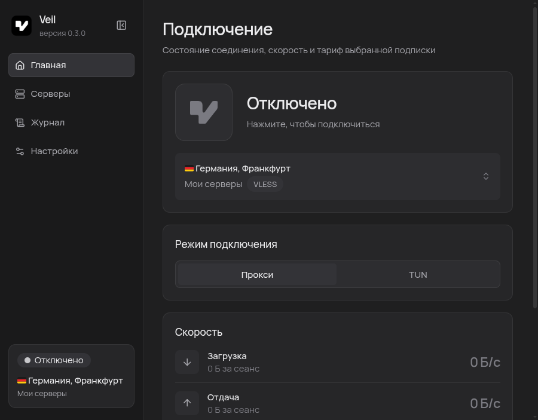

 

## Download

| Platform | Package | Notes |
| --- | --- | --- |
| **Windows** | `.exe` installer | Windows 10 and newer. The installer is not code-signed yet, see [below](#windows-warning) |
| **Linux** | `.deb` | Debian, Ubuntu and derivatives |
| **Linux** | `.rpm` | Fedora, openSUSE and derivatives |
| **Linux** | `.AppImage` | Any distribution; TUN mode is not available |

All files are on the [Releases](https://github.com/maltira/veil-releases/releases/latest) page together with `SHA256SUMS` to verify your download.

## Features

- **Servers and subscriptions.** Add them by link: VLESS, VMess, Trojan, Shadowsocks, Xray JSON and `incy://`. See traffic usage, expiry date and announcements from your provider.
- **Fast server choice.** Check latency and pick the fastest server automatically.
- **Two modes.** System proxy, or TUN to route all traffic of the computer.
- **Clear status.** Connection check with your visible IP, live speed and an event log. A green dot on the tray icon shows when the VPN is on.
- **Yours to tune.** Dark and light themes, fonts, interface scale and 48 app icons.
- **Fits your system.** Tray icon, autostart and opening proxy links in Veil.
- **Under control.** Update check on demand, one-click reset to the first launch.

## Screenshots

  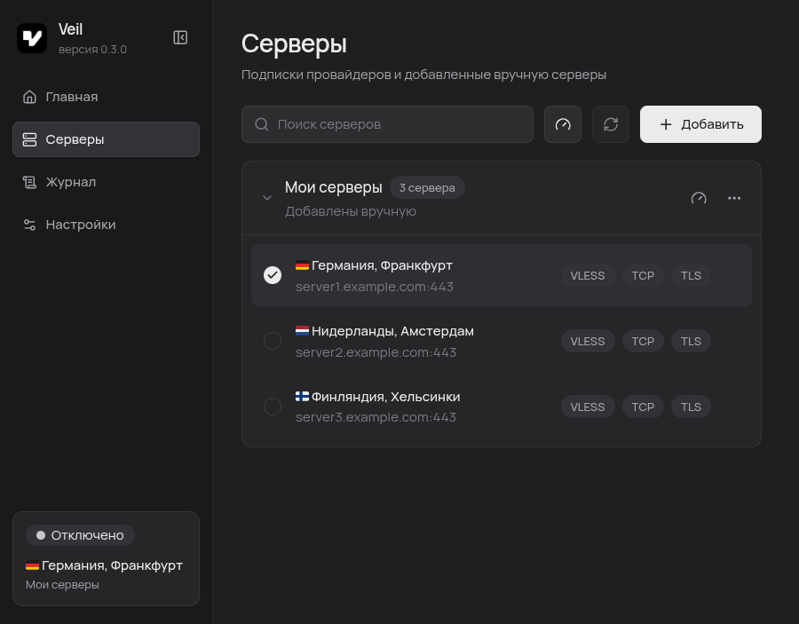
  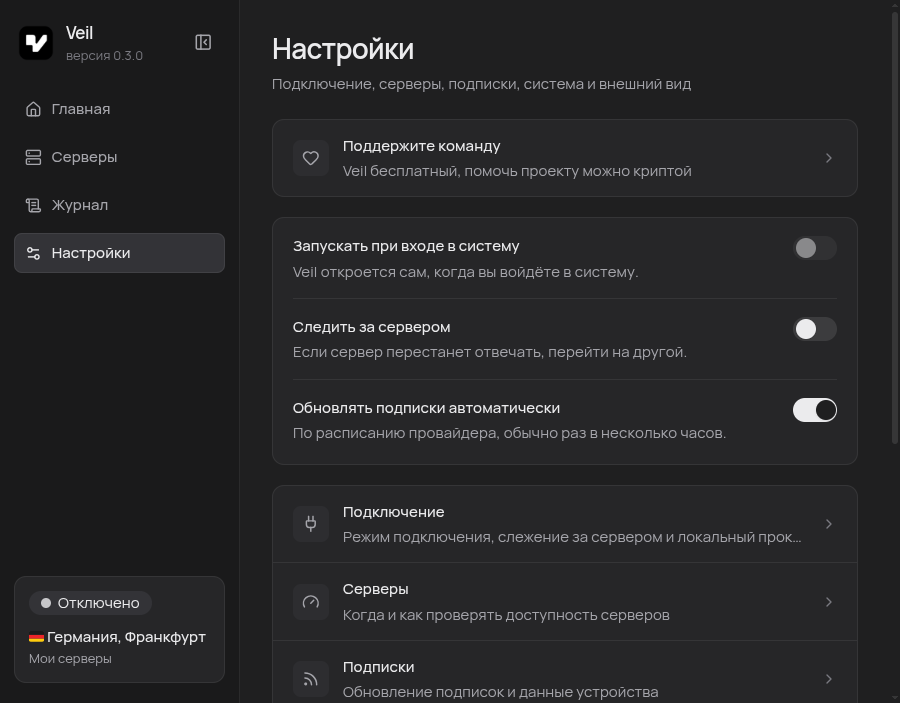

  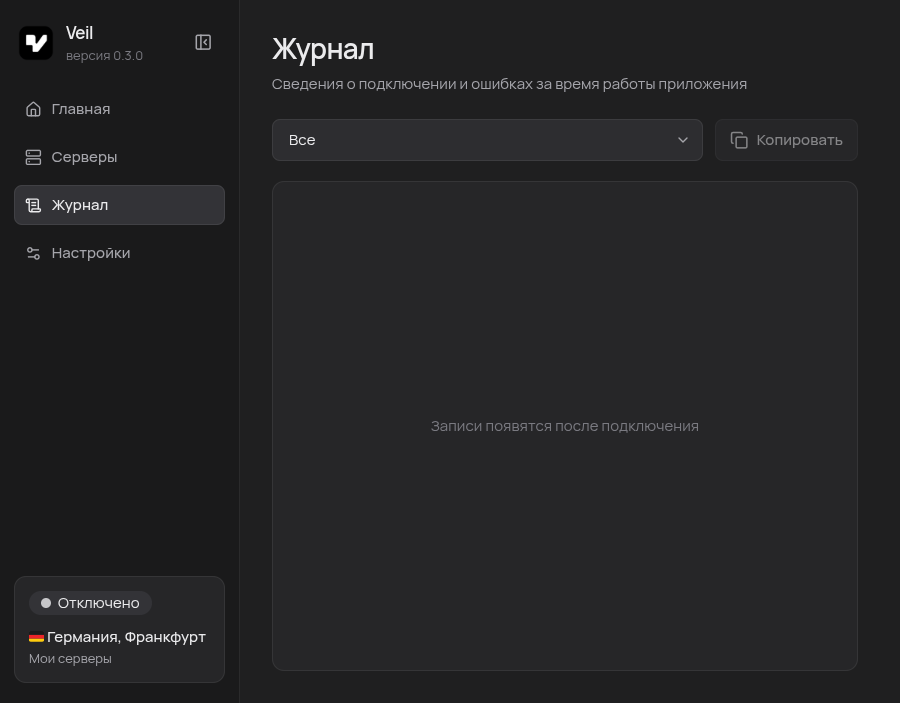
  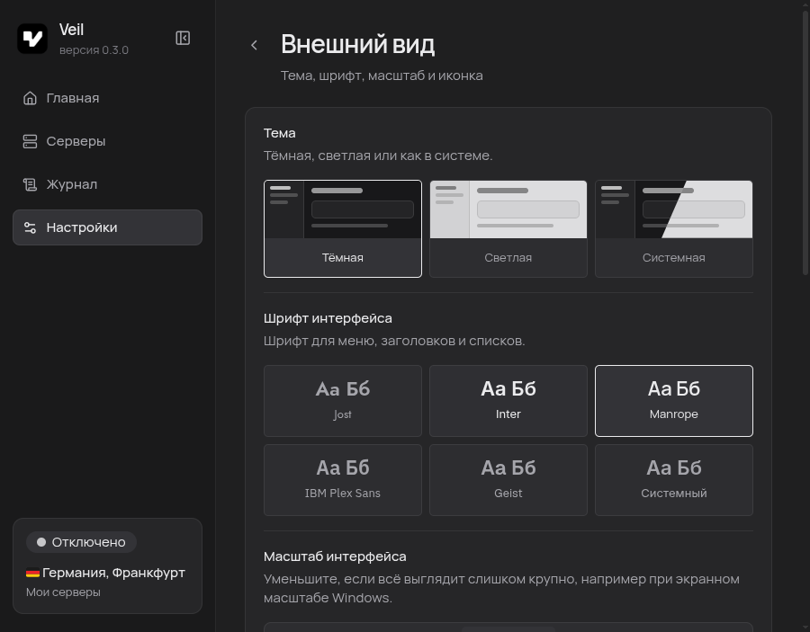

  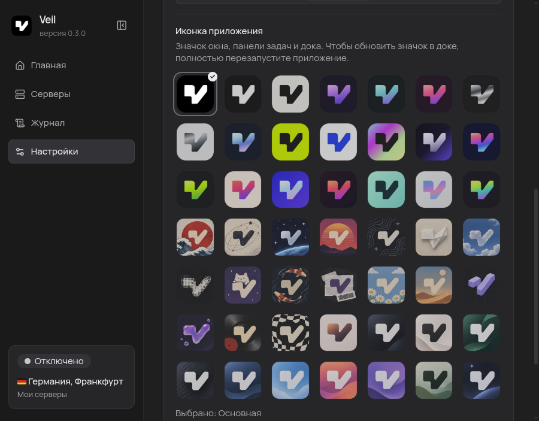
  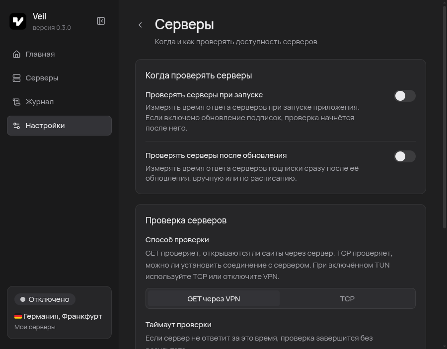

  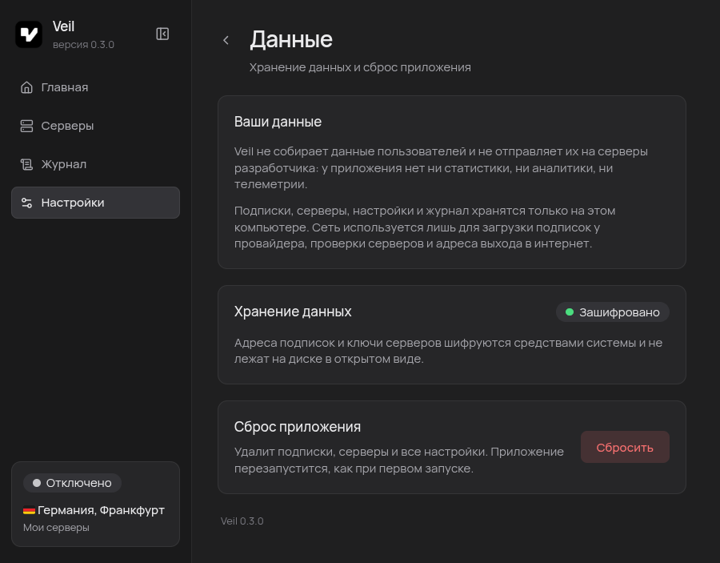

  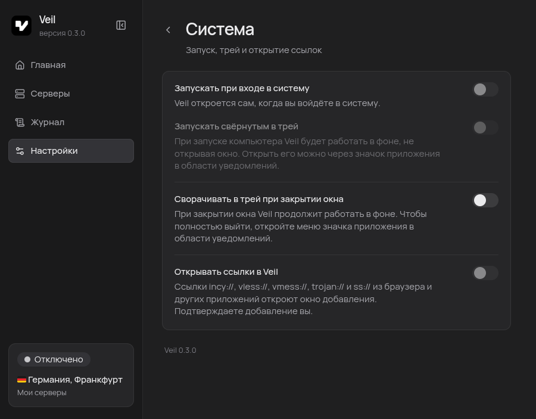
  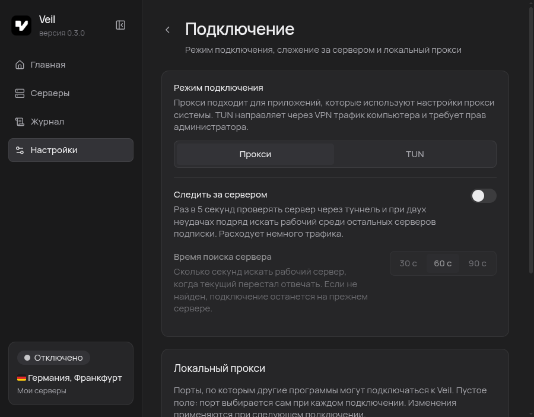

  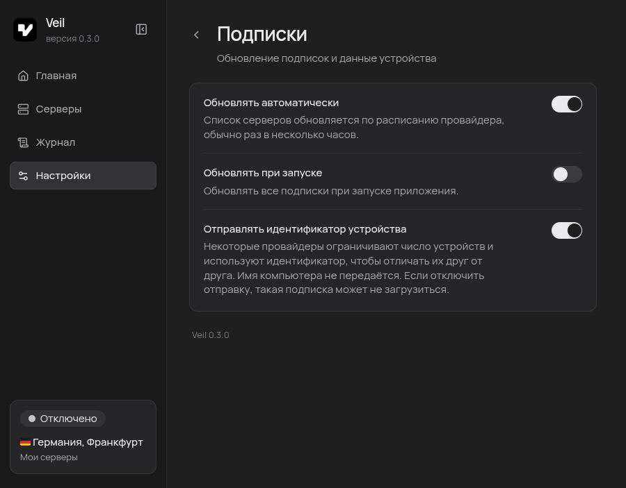

## Notes

- **TUN on Linux** works in the `.deb` and `.rpm` packages only, not in the AppImage. The first time you connect in TUN mode, the system asks for the administrator password once.
- **TUN on Windows** needs administrator rights. Veil offers to restart itself as administrator.
- Windows support is in early testing.

## Windows warning

The installer is not code-signed yet, so Windows SmartScreen may show "Windows protected your PC". Click **More info → Run anyway**. You can check the file against `SHA256SUMS` in the release.

## Your data and uninstalling

Veil keeps everything locally: subscriptions, settings and a random device ID. Nothing is sent anywhere except to your subscription provider.

| System | Data folder |
| --- | --- |
| Linux | `~/.config/veil` |
| Windows | `%APPDATA%\veil` |

To erase all subscriptions and settings, use **Settings → Data → Reset the app**, or close Veil and delete that folder. The Windows uninstaller has a checkbox to delete your saved data too.

Before uninstalling, turn off **Launch at login** and **Open links in Veil** in *Settings → System*. Removing the package cannot clean files in your own profile, so if you forget, a few harmless leftovers stay behind:

- `~/.config/autostart/veil.desktop` (autostart, Linux)
- lines `x-scheme-handler/…=veil.desktop` for `incy`, `vless`, `vmess`, `trojan`, `ss` in `~/.config/mimeapps.list` (Linux)
- `~/.local/share/applications/veil.desktop` and `~/.local/share/icons/veil-custom.png`, only if you changed the app icon (Linux)

Veil restores your system proxy when it disconnects or quits. The TUN permission on Linux belongs to the installed program file and goes away when you remove the package.

## Feedback

Found a bug or have a suggestion? [Open an issue](https://github.com/maltira/veil-releases/issues). Please include the Veil version and system from the *About* page, and do not share subscription links or server keys.

## License

The source code is closed, all rights reserved. Veil includes [Xray-core](https://github.com/XTLS/Xray-core) (MPL-2.0), Electron and other open-source components under their own licenses.

Country flags are drawn with [Twemoji](https://github.com/twitter/twemoji) artwork (© Twitter, Inc. and other contributors), licensed under [CC BY 4.0](https://creativecommons.org/licenses/by/4.0/).
